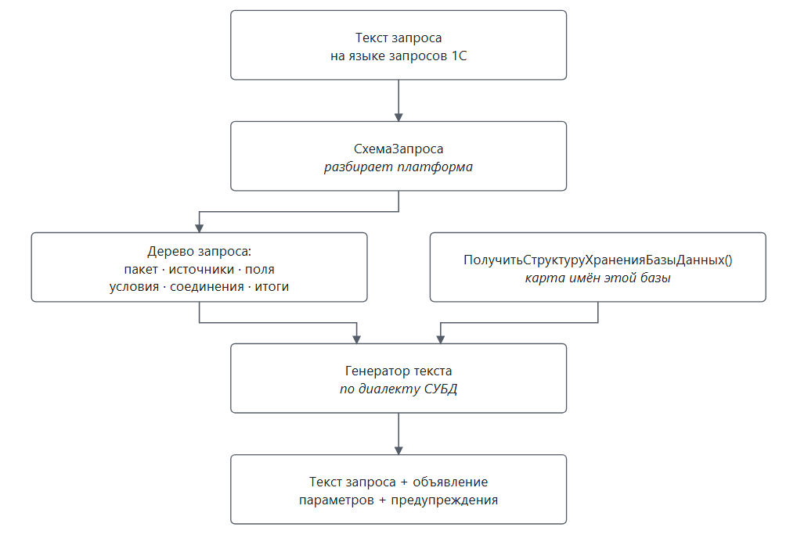
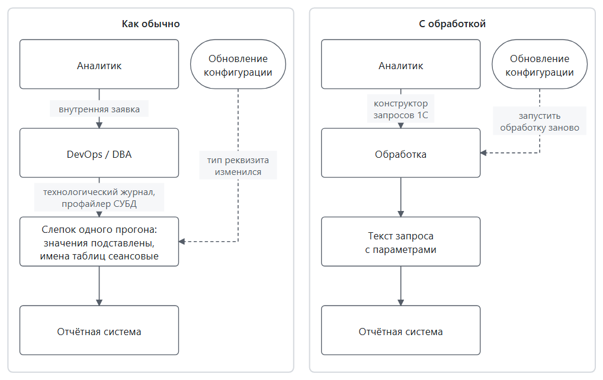
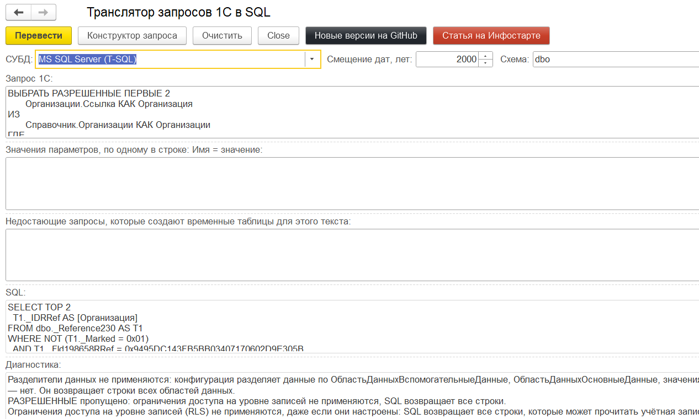
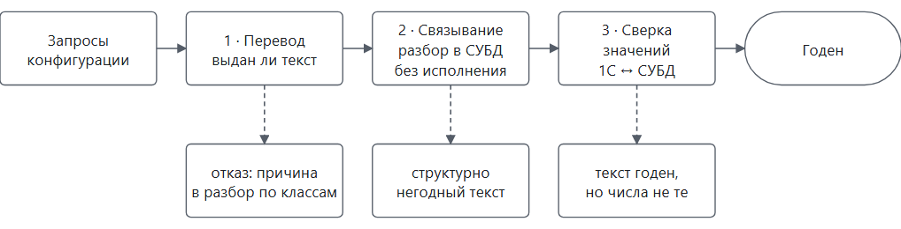

<a href="https://infostart.ru/1c/tools/2855868/"></a>

Статья на Инфостарте: [Транслятор запросов 1С в SQL](https://infostart.ru/1c/tools/2855868/)

# Транслятор запросов 1С в SQL (QueryToSQLTransformer)

Внешняя обработка 1С: берёт текст запроса на языке запросов 1С и выдаёт текст запроса к СУБД
для той базы, где она запущена. К серверу СУБД она не подключается, доступов не открывает,
данные не читает и не меняет. На выходе только текст.

Зачем: аналитику нужны данные из базы 1С в Power BI или другой отчётной системе, которая умеет
SQL и не умеет язык запросов 1С. Обычный путь — заявка администратору на перехват запроса или
запрос к СУБД руками по физическим именам таблиц (`_Reference118`, `_Fld2407`). Обработка снимает
эту заявку: запрос пишется на языке 1С — в конструкторе, в консоли запросов, в схеме СКД готового
отчёта — и переводится автоматически.

Пример из «Управления холдингом» — `Справочник.Организации`, метод `ПолучитьОрганизациюПоУмолчанию`.
Сверху то, что написано в модуле, снизу то, что отдала обработка:

```sql
ВЫБРАТЬ РАЗРЕШЕННЫЕ ПЕРВЫЕ 2
	Организации.Ссылка КАК Организация
ИЗ
	Справочник.Организации КАК Организации
ГДЕ
	НЕ Организации.ПометкаУдаления
	И Организации.Статус = ЗНАЧЕНИЕ(Перечисление.СтатусыОрганизацийПодразделений.Действует)
```

```sql
SELECT TOP 2
  T1._IDRRef AS [Организация]
FROM dbo._Reference230 AS T1
WHERE NOT (T1._Marked = 0x01)
  AND T1._Fld198658RRef = 0x9495DC143FB5BB03407170602D9E305B
```

Булево поле хранится байтом и сравнивается с `0x01`, значение перечисления записано 16-байтовым
литералом ссылки. `РАЗРЕШЕННЫЕ` в SQL не попало: ограничения доступа на уровне записей обработка не
переносит и предупреждает об этом (раздел «Что остаётся за пределами»).

## Как это работает

Своего разборщика языка запросов в обработке нет — и это главное решение проекта.
Запрос разбирает сама платформа объектом `СхемаЗапроса` (`QuerySchema`), а логические имена таблиц
и полей переводятся в физические через `ПолучитьСтруктуруХраненияБазыДанных()`. Поэтому обработка
понимает язык запросов ровно так, как понимает его платформа, и не расходится с ней на краевых
случаях. Оба средства документированы, недокументированных возможностей обработка не использует.



Следствие, о котором надо помнить: **физические имена принадлежат конкретной информационной
базе**. В другой базе той же конфигурации номера таблиц и полей другие, поэтому запускать обработку
надо в той базе, для которой нужен SQL.

Перехваченный из технологического журнала или профайлера текст — слепок одного прогона: значения
параметров подставлены, имена временных таблиц сеансовые, а если реквизиту при обновлении поменяли
тип (например, сделали составным), меняется и набор его колонок, и такой запрос падает или молча
отдаёт не то. Запрос на языке 1С от базы и способа хранения не зависит: хранится он, а SQL получается
из него заново.



## Что нужно и кто запускает

- **База:** клиент-серверная, MS SQL Server — диалект `MSSQL`, проверен всеми слоями (ниже).
  PostgreSQL — диалект `PostgreSQL`, **экспериментальный**: конструкций T-SQL в выводе нет, но на
  живом сервере он не проверялся, поэтому ни связывание, ни сверка значений на нём не проводились.
- **Платформа:** 8.3.24 и новее; проверено на 8.3.24.1528 и 8.3.27.2214.
- **Права:** полные права в 1С. С другими ролями обработка не проверялась. Поэтому запускает её
  обычно разработчик или администратор 1С, а аналитику достаётся готовый текст запроса.
- **Язык:** форма, предупреждения и отказы — на русском или английском, по языку пользователя
  информационной базы. Язык конфигурации и язык запроса на это не влияют.

## Как пользоваться

Открыть `build/QueryToSQLTransformer.epf` в базе: **Файл → Открыть** или через «Дополнительные
обработки». Вставить запрос или собрать его конструктором, выбрать СУБД и нажать «Перевести».
Значения параметров — по одному в строке «Имя = значение». Если запрос читает временную таблицу,
которую создаёт другой запрос того же метода, запрос, создающий её, кладётся в поле «Недостающие
запросы» (в программном интерфейсе это `Prologue`); таблица, переданная параметром (`ИЗ &Таблица`),
берётся из одноимённой временной таблицы этого поля.



Из кода:

```bsl
Processor = ExternalDataProcessors.Create("QueryToSQLTransformer.epf", False);
Options = Processor.DefaultOptions();
Options.Dialect = "MSSQL";
Options.Language = "ru"; // язык ErrorDescription и Warnings: "en" (по умолчанию) или "ru"
Options.ShiftDates = True; // даты результата без смещения лет базы, как их видит 1С
Result = Processor.Transform(QueryText, Options);
If Result.Success Then
    Message(Result.SQL);
Else
    Message(Result.ErrorDescription);
EndIf;
```

Пакетно по всем отчётам конфигурации — `TransformConfiguration(Options, Kinds, NameFilter)`: она
обходит отчёты (или обработки), достаёт запросы из схем компоновки данных и возвращает таблицу
значений, по строке на набор данных: объект, макет, набор, SQL, отказ и предупреждения. Исходная
цель — чтобы из ста отчётов заявка администратору оставалась нужна для одного-двух.

**Даты в результате.** 1С хранит даты со смещением лет, заданным при создании базы (обычно 2000 или 0), и
вычитает его уже после запроса. Форма возвращает колонки дат итогового запроса без смещения, как их видит
1С: `DATEADD(YEAR, -2000, CAST(Поле AS DATETIME2(0)))` — через `datetime2`, потому что пустая дата 1С при
смещении 2000 хранится как 2001-01-01 и после вычитания не помещается в `datetime`. Из кода это настройка
`ShiftDates` (по умолчанию `False`: даты как хранятся). Части составных значений (`_T`) и колонки временных
таблиц остаются в хранимом виде, как у платформы.

## Примеры

В каталоге [`examples/`](examples/) — наборы по двум конфигурациям. Каждый пример взят из
конфигурации как есть, а не придуман для показа: показывает запрос 1С и полученный из него SQL и
называет модуль и метод, где этот запрос лежит.

## Проверка на своей базе

Примеры можно проверить на своей копии той же конфигурации: запрос выполняется в 1С, его перевод -
в MS SQL, и результаты сравниваются. Физические имена таблиц в ваших базах свои, поэтому SQL из
примера не копируется, а получается обработкой заново.

**Автоматически - скриптом** `tools/check_examples.py` (Windows, Python 3.11+, `pip install pywin32
pyodbc`). Скрипт подключается к базе через COM - это сеанс 1С, ему нужна одна свободная лицензия, - и
по очереди берёт все файлы `*.md` и `*.txt` из папки примеров, включая добавленные вами:

```
set Q2S_IB=Srvr="сервер1С";Ref="база";
set Q2S_IB_USER=Администратор
set Q2S_SQL=Driver={ODBC Driver 18 for SQL Server};Server=серверSQL;Database=база;Trusted_Connection=yes;TrustServerCertificate=yes
python tools\check_examples.py --examples examples\ERP_UH33
```

Пароль пользователя 1С скрипт спросит при запуске (или возьмёт из `Q2S_IB_PASSWORD`), пароль входа
SQL, если нужен, - из `Q2S_SQL_PASSWORD`; в файлах они не хранятся. Если COM-коннектор не
зарегистрирован или зарегистрирован от другой версии платформы, укажите её каталог: `--bin
"C:\Program Files\1cv8\8.3.24.1528\bin"`. Для каждого файла скрипт пишет итог - «совпало»,
«совпало, пусто» (ноль строк с обеих сторон ничего не доказывает), «расходится» с первой разницей,
«отказ» с причиной, «пропущено» (нет значений параметров или данных для них) - и сохраняет отчёт
`check-report.md`. Проверка - только для MS SQL: PostgreSQL в обработке экспериментальный.

Значения параметров - раздел `## Параметры` в файле примера, строками `Имя = значение`. Значение -
литерал (`2018-01-01`, `10`, `"строка"`, `ИСТИНА`) или запрос 1С, который выполнится в вашей базе:

```
Организация = ВЫБРАТЬ ПЕРВЫЕ 1 Т.Ссылка ИЗ Справочник.Организации КАК Т
СписокОрганизаций = ВЫБРАТЬ Т.Ссылка ИЗ Справочник.Организации КАК Т
ДатаНачала = 2018-01-01
```

Своему запросу достаточно файла `.txt` с его текстом (без параметров) или `.md` по образцу примеров.

**Вручную - без Python:**

1. Открыть обработку, вставить текст запроса 1С, задать значения параметров, перевести.
2. Тот же запрос с теми же значениями выполнить в консоли запросов 1С.
3. Полученный SQL выполнить в SQL Server Management Studio на базе этой же информационной базы.
4. Сравнить число строк и значения. Ссылки в SQL - 16 байт (`_IDRRef`), в консоли 1С - представления;
   для сверки удобно добавить в запрос 1С колонку `Ссылка` и сравнивать по ней.

## Сколько запросов переводится

Измерено, а не оценено, и измерено двумя мерками — потому что «перевелось» и «работает»
это разное. Проверка идёт на всех запросах двух конфигураций, по классам конструкций:
выборка и условия, соединения, обращение через точку, группировки и итоги, объединения,
подзапросы, временные таблицы, пакеты, виртуальные таблицы регистров, параметры. Берутся
две конфигурации — англоязычная ERP WE 2.5.27.50 и русскоязычная «Управление холдингом» 3.3.4.7.
Обработка читает метаданные той базы, в которой запущена, поэтому доработанные объекты для неё такие же,
как типовые; типовые конфигурации взяты, чтобы числа мог повторить любой.

| что считаем | англоязычная | русскоязычная |
|---|---|---|
| запросов в корпусе (все тексты запросов из модулей и форм) | 20 721 | 50 896 |
| обработка выдала текст SQL | 10 292 | 26 843 |
| СУБД разобрала текст и связала все имена | **10 292 (100 %)** | **26 839 (99,99 %)** |
| отказ, потому что не хватает входа | 9 838 | 22 132 |
| отказ: текст или условие отвергает сама 1С | 586 | 1 913 |
| отказ: часть работы платформа делает после СУБД | 3 | 6 |
| отказ: перевод этой формы ещё не сделан | 1 | 1 |
| перевод не уложился в предел времени проверки | 1 | 1 |

Перепись 23.11.2026, на публикуемой версии.

«Не хватает входа» почти всегда означает чужую временную таблицу: запрос в модуле продолжает пакет,
начатый в другом месте кода, и без того текста SQL не построить (31 тыс. запросов на двух базах).
Остальное — значение параметра, от которого платформа строит SQL (тип ссылки, список видов субконто,
`КритерийОтбора`, `МоментВремени`). «Отвергает сама 1С» — в основном заготовки и обрывки, которые код
дособирает перед исполнением, и три отбора по имени предопределённого элемента, которого в конфигурации нет. Настоящих пробелов — запросов, которые исполняются в СУБД, а перевода
для них нет, — 2 из 71 617, и каждый из них назван в отказе. Это одна форма: `ВЫБОР` «представление ссылки
или строка», который уходит во временную таблицу, а дальше его группируют и берут от него `МАКСИМУМ`. Платформа
хранит такую колонку частями значения и различает строки по ним, а перевод этих частей во временной таблице пока не
строит. Ещё по одному запросу на конфигурацию - пакеты около 90 КБ: их перевод занимает 4-5 минут и в предел
времени проверки не уложился.

Четыре перевода русскоязычной базы, которые СУБД не связала, — параметры без значения: тип
переменной в шапке СУБД вывести не может.

Переведённых меньше, чем было бы при переводе «как получится»: часть запросов обработка
теперь честно отвергает — например, арифметику над числовым параметром без значения, где
разрядность результата зависит от самого значения (об этом ниже).

Вторая строка важнее первой. Текст бывает синтаксически верным, но ссылается на колонку,
которой в таблице нет, — такой запрос не выполнится. Проверять это через `SET PARSEONLY`
бесполезно: он смотрит только синтаксис. Нужен `sys.dm_exec_describe_first_result_set` —
СУБД разбирает текст и связывает имена, ничего не выполняя.

Две конфигурации берутся не для объёма: русскоязычная проверяет ветки разбора, которых
в англоязычном наборе нет вовсе. Это не умозрительная польза — самый крупный класс
отказов, найденный на ней, существовал только там, потому что служебное имя вложенной
таблицы схема запроса отдаёт на языке платформы.

Часть запросов обработка **отвергает сознательно**, когда перевод был бы неверным, —
например отбор по имени предопределённых данных, которого в базе нет, или агрегат от
составного поля. Отказ лучше похожего, но другого результата.

Проверка идёт восемью слоями; каждый следующий появился после того, как прежние что-то пропустили.

| слой | вопрос, на который он отвечает |
|---|---|
| перевод | выдала ли обработка текст, и если нет, по какой причине |
| связывание | разобрала ли СУБД текст и нашла ли все таблицы и колонки (`sys.dm_exec_describe_first_result_set`) |
| число строк | столько же строк вернул SQL, сколько платформа |
| значения | совпали ли сами значения, колонка за колонкой, с приведением ссылок, дат и булева |
| типы колонок | совпал ли тип каждой числовой колонки с типом SQL платформы, даже на пустом результате |
| тихая потеря | не исчезла ли конструкция запроса молча: её след обязан быть в SQL или в предупреждении |
| два языка | дают ли русская и английская запись один и тот же SQL |
| набор на класс | есть ли у каждого класса конструкций не меньше пяти сравнений **на непустых данных** |



Последнее правило — не формальность: без него класс, все сравнения которого вышли пустыми, молча
попадал в «совпало», а ноль строк с обеих сторон не доказывает ничего.

На новом корпусе и текущей сборке выборка сверки (до 400 запросов на базу, отобранных по классам
конструкций) дала **ноль расхождений** по значениям: сверено 186 запросов на англоязычной базе и 248 на
русскоязычной, из них непустых 104 и 158. По типам колонок сверено 165 и 205, расхождений нет. Сверх корпуса
есть батарея из 1 328 написанных вручную случаев, каждый сверяется с самой 1С: конструкции языка запросов по
справке платформы, пограничные значения (NULL, НЕОПРЕДЕЛЕНО, пустые ссылки, концы месяцев, деление,
округление половины, пустые строки) и формы, которые платформа отвергает сама.

Полная сверка всех запросов, которые можно исполнить в базе (23.11.2026, на публикуемой версии), сверила по
значениям 4 732 запроса на англоязычной конфигурации и 16 005 на русскоязычной, из них непустых 2 496 и 9 308.
Разошлись 0 и 2, и оба расхождения - устаревший эталон в кеше сверки: справочник версий расширений меняется при
каждой загрузке расширения, и без кеша оба запроса совпали. Предыдущая полная сверка нашла один настоящий дефект -
имя предопределённого элемента у пустой ссылки (`Родитель.ИмяПредопределенныхДанных` у элемента верхнего уровня)
выходило пустой строкой, а у платформы это NULL; он исправлен. Прежде сверка такую колонку снимала как «пустая ссылка
против „нет значения“, различить нельзя», а теперь сравнивает, если число NULL у сторон одинаково. По типам колонок
сверено 3 902 и 13 115 запросов, разошлись 12 и 81 - значения у них совпадают, расходится объявленная разрядность
колонки. Остаток назван, а не спрятан: у `ОстаткиИОбороты` разрядность итогов у платформы зависит от значения даты
периода, у итогов регистров накопления во вложенных запросах - от формы обращения к регистру.

Числа этой сверки стоит назвать прямо, потому что они и есть мера доверия. По классам
конструкций расхождений значений **нет ни одного** — на обеих конфигурациях. Три класса
на англоязычной базе набрали меньше пяти непустых сравнений, и это предел не проверки,
а базы: столько запросов в выборке просто нет (`УНИЧТОЖИТЬ` — 31, обороты регистров — 40,
`АВТОУПОРЯДОЧИВАНИЕ` — 6). Виртуальные таблицы бухгалтерского регистра в выборке почти
не встречаются, поэтому проверены отдельными запросами: остатки, обороты, остатки
и обороты, обороты Дт/Кт и движения с субконто — от 110 до 3 596 строк, всё совпало.

Что сравнить нельзя в принципе, названо отдельно, а не спрятано в «совпало»: `ИТОГИ` -
итоговые строки платформа достраивает уже после СУБД.

Два случая долго числились в этом же списке, и оба оттуда ушли. `РАЗРЕШЕННЫЕ` обработка
не переводит намеренно, но сверке это не мешает: слово снимается с текста, который
исполняет 1С, и тогда обе стороны видят все строки - сверяется ровно то, что переводится.
А `ПЕРВЫЕ N` с отсечением действительно делает выбор среди равных по порядку
неопределённым, но проявляется это **только расхождением**: если строки совпали, значения
сверены, и отказываться от такого сравнения не за что. Поэтому решение принимается после
сравнения, а не до него.

Отдельно стоит сказать про саму проверку. Десятки расхождений за всё время оказались не
дефектами перевода, а ошибками сверки: пустая дата, которую COM отдаёт сдвинутой; дата
параметра, уезжавшая на часовой пояс; несравнимая колонка, отменявшая сравнение всего
запроса; чужое смещение дат; пустые ссылки разных типов, которые в СУБД равны, а в 1С нет. Поэтому каждое расхождение сначала проверяется на то, не врёт
ли сама сверка, — и только потом признаётся дефектом.

Отдельным набором проверены составные поля: выборка, `РАЗЛИЧНЫЕ`, упорядочивание,
группировка, временная таблица, объединение с односоставной ветвью. И отдельно: один
и тот же запрос, записанный русскими и английскими словами, даёт побайтово одинаковый SQL.

## Составные поля в результате

Поле, тип которого допускает несколько вариантов — ссылку на один из нескольких
справочников, ссылку или строку, — 1С хранит не одной колонкой, а несколькими:
тег типа, примитивные значения, ссылочные части. Платформа читает их все и
собирает значение обратно уже после того, как СУБД ответила.

Обработка делает то же: такое поле выводится своими колонками хранения, с
суффиксом роли к псевдониму поля.

| колонка | что в ней |
|---|---|
| `V` | байты ссылки — то же, что `V_RRRef`; оставлена для удобства |
| `V_TYPE` | тег типа: `0x01` неопределено, `0x02` булево, `0x03` число, `0x04` дата, `0x05` строка, `0x08` ссылка |
| `V_L`, `V_N`, `V_T`, `V_S` | значение, когда оно булево, число, дата или строка |
| `V_RTRef` | какой таблице принадлежит ссылка |
| `V_RRRef` | байты ссылки |

Читать так же, как читает платформа: `V_TYPE` говорит, в какой колонке лежит
значение. Состав колонок зависит от типа поля — у поля только из ссылок их три,
у поля с примитивами семь, у регистратора две (тега типа нет, он всегда ссылка).

Одной колонкой такое поле отдавать нельзя: ссылки разных таблиц с одинаковым
uuid в результате неразличимы, а примитивное значение теряется целиком.

Части выводятся не только у хранимого поля, но и у вычисляемого: `ВЫБОР` с ветвями
разных типов, `ЕСТЬNULL(ссылка, примитив)`, ветвь `НЕОПРЕДЕЛЕНО`, приведение,
переход через точку по составной ссылке, ветвь `ОБЪЕДИНИТЬ`, которая отдаёт примитив
там, где другая отдаёт ссылку. Правило у платформы одно на все эти
конструкции — она повторяет скелет выражения по одному разу на каждую роль, —
и обработка повторяет его же.

`НЕОПРЕДЕЛЕНО` при этом — значение, а не `NULL`: оно равно самому себе, и условие
`Поле = НЕОПРЕДЕЛЕНО` в 1С бывает истинным. Платформа хранит его тегом типа `0x01`
и сравнивает по тегу; обработка делает так же. Перевод через `NULL` исполнялся бы без
ошибки и молча терял строки соединения.

У колонки, где смешаны **разные виды** значений (ссылка рядом со строкой, числом или
датой), главной колонки значения нет: единого типа для неё в SQL не существует,
и платформа такой колонки тоже не выводит. Возвращаются только части, а предупреждение
говорит читать `V_TYPE` первым.

Если же такое значение **вычисляется и кладётся во временную таблицу**, обработка
отказывается. Там колонка обязана существовать по имени — следующие запросы пакета
обращаются к ней, — а положить в одну колонку и ссылку, и строку нельзя: СУБД приводит её
к одному типу **молча**. Замерено: ссылка рядом со строкой возвращается текстом вроде
`袑Ⓖḑ쥙…`, рядом с числом — целым `1983302584`; и то и другое связывается и исполняется без
ошибки. Выдать такое хуже, чем отказаться. Идентификатор таблицы (`V_RTRef`) выводится лишь тогда,
когда он неоднозначен — то есть при двух и более ссылочных типах; при одном типе платформа
его не выводит, и обработка тоже.

## Что остаётся за пределами

Тот процент, который СУБД не связала, разложен по причинам — по убыванию веса:

- **Тип параметра, который схема запроса не знает.** Крупнейшая причина. Там, где тип
  выводится из сравнения, из `МЕЖДУ` или из позиции периода виртуальной таблицы, обработка
  его ставит; в остальных случаях параметр получает `BINARY(16)`, и если в запросе он
  сравнивается с датой или числом, СУБД такой текст не связывает. Тип правится в шапке
  запроса — одно место на запрос.
- **Числовой параметр без значения в арифметике — отказ.** Тип параметра платформа выбирает
  по значению: целое — `NUMERIC(10)`, до восьми знаков после запятой — `NUMERIC(38, 8)`,
  больше — точный тип. От него СУБД выводит разрядность частного, произведения и суммы, и
  без значения результат был бы похожим, но другим. Значение передаётся настройкой
  `ParameterValues` — достаточно образца той же разрядности, — и запрос переводится точно.
- **Список видов субконто без значения — отказ.** Список, переданный в виртуальную таблицу
  бухгалтерского регистра параметром, не только перенумеровывает колонки `Субконто1/2/3`, но
  и **отбирает счета**: остаются только те, у которых есть каждый вид списка (замерено: со
  списком из двух видов остатки дал 1 счёт из 115). Без значения неизвестны сами строки;
  значение задаётся через `ParameterValues`.
- **Несовместимые типы.** 1С складывает и сравнивает то, что T-SQL несовместимым считает:
  число с датой, `NULL` под агрегатом.
- **Синтаксис.** Разнородный остаток: конструкции, которые разбираются в выражение
  неверной формы.
- **Колонка не в `GROUP BY` и не под агрегатом.** Платформа досчитывает группировку
  сама, T-SQL требует перечислить всё явно.
- **Прочее мелочью:** объект не найден, условие там, где СУБД ждёт значение, колонка
  не найдена, несвязанный псевдоним.
- **Вложенные таблицы в списке выборки.** `Справочник.ТабличнаяЧасть.( Поле )` даёт
  в 1С колонку, значением которой является таблица. В SQL такого типа нет: платформа
  строит её отдельным запросом уже после того, как СУБД ответила. Правило проекта —
  повторять только то, что делает СУБД, поэтому такая колонка **опускается**, а в
  предупреждениях называется поимённо: табличную часть надо выбрать отдельным запросом
  и соединить по ссылке.
- **Голый `NULL` в списке выборки и `МАКСИМУМ`/`МИНИМУМ` от составного поля** прежде отказывали,
  теперь переводятся так же, как у платформы. `NULL` в ветви объединения становится
  `CAST(NULL AS <тип колонки>)` по частям: позицию такой колонки модель запроса всё-таки хранит,
  в `Columns[i].Fields`. Максимум составного платформа считает сначала по тегу типа, потом по
  байтам ссылки — `SUBSTRING(MAX(_RTRef + _RRRef), 5, 16)`; максимум по одной колонке ссылки дал
  бы другую строку.
- **`ПРЕДСТАВЛЕНИЕ`, переопределённое в модуле менеджера.** Представление платформа
  складывает **после** запроса: в SQL она выбирает поля, а строку собирает код. Шаблон
  платформы обработка повторяет точно — у справочника это наименование или код (смотря на
  основное представление; числовой код идёт с разделителями разрядов, а когда поля показа
  нет — `<>`), у документа «представление объекта, номер, слово, дата». Формат обработка снимает
  в своём сеансе, и источников у него **два**: формат даты и разделитель разрядов приходят
  из региональных установок информационной базы, а слово между номером и датой и слово
  булева — из языка интерфейса платформы. Замерено на базе, где региональные установки уже
  были русскими, а платформа оставалась английской: дата шла как `17.12.2010 17:46:36`, а
  слово — `dated`. Ни язык конфигурации, ни язык пользователя информационной базы на это не
  влияют. `Строка()` в том же сеансе отдаёт ровно то, что платформа кладёт в представление,
  на этом калибровка и держится; замерены три набора формата — `dd/MM/yy HH:mm:ss`,
  `M/d/yyyy h:mm:ss tt` и русский `dd.MM.yyyy H:mm:ss` (час без ведущего нуля, разряды
  отделены неразрывным пробелом).

  Отсюда важное для выгрузки: когда в региональных установках базы взведено «использовать
  региональные установки текущего сеанса», формат — свойство **сеанса**, а не базы, и двое
  пользователей видят представление одного документа по-разному. Полученный SQL несёт формат
  того сеанса, в котором выполнялся перевод, а в принимающей системе сеанса 1С уже нет. Время в дате появляется не
  всегда: если стандартному реквизиту «Дата» задан формат `DLF=D` (он же `ДЛФ=D`),
  платформа показывает только дату, и обработка делает то же — на двух конфигурациях таких
  типов 7 и 211. Любой другой формат не угадывается: обработка отказывается и печатает его.
  Чего обработка повторить не
  может — это `ОбработкаПолученияПредставления` в модуле менеджера: конфигурация вправе
  собрать представление своим кодом, и тогда текст будет другим. Замерено на сорока типах с
  данными: на одной конфигурации так делают 4 типа, на другой — 13, и шаблоны у них свои
  («ЗВ-001 от 15.08.2023 (вер. 1 от 18.09.2023)», «Амортизация НМА ПР00-000001 за January
  2017»). Такое представление обработка переводит по шаблону платформы и предупреждает
  отдельной строкой; где текст важен буквально, надёжнее выбрать поля и собрать строку на
  принимающей стороне. Если региональные установки базы не попали в замер, обработка
  отказывается и печатает образец, который дал её сеанс.
- **Чужая временная таблица.** Запрос, читающий временную таблицу, созданную другим запросом,
  без текста этого запроса не переводится: таблицы в базе нет. Запрос, создающий её, кладётся в
  поле «Недостающие запросы» (`Prologue`), и тогда перевод идёт. Без него — отказ с причиной; в
  доли выше такие запросы входят как «не хватает входа».
- **Очень большой пакет.** Временные таблицы пакета обработка выводит как `WITH`, а MS SQL
  раскрывает такое выражение в каждом месте, где на него ссылаются. Замерен один запрос из
  36 тысяч — пакет в 30 КБ текста: имена СУБД связывает, а план построить не может
  (ошибка 8623, «query processor ran out of internal resources»). Платформа пишет настоящие
  временные таблицы и этого предела не встречает. Такой пакет надо разбить на шаги и
  материализовать промежуточные таблицы самому.
- **`РАЗНОСТЬДАТ` для PostgreSQL.** MS SQL считает пересечения границ периода, а не полные
  единицы. Повторить это одной формулой нельзя, а выдать похожее, но другое — худший
  исход: числа разойдутся молча. Обработка отказывается явно.
- **То, что платформа делает вне запроса к СУБД.** В SQL этого нет и быть не может; обработка
  предупреждает о каждой части:

  | что в запросе | что делает платформа | чем это грозит |
  |---|---|---|
  | `РАЗРЕШЕННЫЕ` | достраивает запрос ограничениями доступа на уровне записей | **SQL возвращает все строки**, включая недоступные пользователю |
  | `ИТОГИ` | считает итоги над результатом выборки | возвращаются только детальные строки |
  | `ИНДЕКСИРОВАТЬ ПО` | создаёт индекс временной таблицы | индекса нет, план выполнения другой |
  | `АВТОУПОРЯДОЧИВАНИЕ` | достраивает порядок по представлениям ссылок | строки придут в другом порядке |
  | разделители данных | подставляет значения разделителей сеанса | **строки всех областей данных**, а не своей |
  | `{ … }` в фигурных скобках | строит отбор динамического списка, когда его задал пользователь | отбор надо задать заново в отчётной системе |

  **RLS обработка не дописывает вообще**: ни при слове `РАЗРЕШЕННЫЕ`, ни без него, даже если
  ограничения в базе включены и настроены. SQL видит все строки, которые видит учётная запись СУБД, и
  об этом обработка пишет в предупреждениях к каждому переводу. Разграничение доступа и разделение по
  областям придётся обеспечивать средствами отчётной системы. Как это сделать, например, в Power BI —
  тема отдельная; замечу только, что такую отчётность обычно строят не на СУБД рабочей базы, а на её
  копии, к которой 1С даже не подключена: отчёты не мешают работе пользователей и не ждут на
  блокировках, а платой служит отставание данных на время обновления копии.

## Что поддержано

Какие конструкции языка запросов поддержаны — видно по [`examples/`](examples/): 58 примеров
покрывают выборку и условия, соединения, обращение через точку, группировку и итоги,
объединения, подзапросы, временные таблицы, пакеты, виртуальные таблицы регистров
и параметры. Чего там нет — перечислено выше, в разделе о пределах.

## Аналоги на Инфостарте

- [«Трансформатор 1С - SQL»](https://infostart.ru/public/639443/) (2017) снимает трассировкой SQL, который
  реально выполнила платформа, и подписывает его именами 1С: настоящий запрос вместе с RLS, но слепок одного
  прогона и доступ к трассировке сервера СУБД.
- [«Универсальный переводчик запросов 1С в T-SQL»](https://infostart.ru/1c/tools/238239/) (2013) переводит
  имена выделенного фрагмента и ключевые слова, полувручную, без виртуальных таблиц.
- [«Однопальцевое преобразование „одинэсного“ запроса в запрос на SQL»](https://infostart.ru/1c/tools/1426693/)
  (2021–2024) тоже разбирает запрос средствами платформы; большая часть функций и виртуальных таблиц, составные
  типы, RLS и разделение данных, по словам автора, не поддерживаются.
- [«Модель запроса SQL»](https://infostart.ru/1c/articles/1871072/) (2023–2024) собирает SQL из кода на
  встроенном языке и выполняет через ADODB, готовый запрос 1С не переводит.

Эта обработка отличается полнотой и проверкой: виртуальные таблицы, составные типы и правила, которые
платформа применяет до СУБД, сняты замером и сверены с 1С на всех запросах двух конфигураций, а то, что не
замерено, она не переводит и называет причину.

## Скачать

Бесплатно — здесь, в репозитории: готовая обработка [`build/QueryToSQLTransformer.epf`](build/), исходники
в формате выгрузки Конфигуратора ([`1c/`](1c/)), примеры и скрипт проверки. Новые версии выходят только
здесь. Статья о том, как обработка появилась и как проверялась, — на Инфостарте:
[Транслятор запросов 1С в SQL](https://infostart.ru/1c/tools/2855868/); там же приложен файл.

## Изменения

- **0.3.1** — колонки дат итогового запроса возвращаются без смещения лет базы (настройка `ShiftDates`,
  в форме включена). Раньше на базе со смещением 2000 дата приходила как 4026 год.
- **0.3.0** — первая публичная версия.

## Лицензия

MIT с условием Commons Clause — см. [LICENSE](LICENSE). Пользоваться, менять и встраивать обработку можно,
в том числе в компании, с сохранением упоминания авторства. Продавать саму обработку или платную услугу,
построенную на ней, нельзя.
